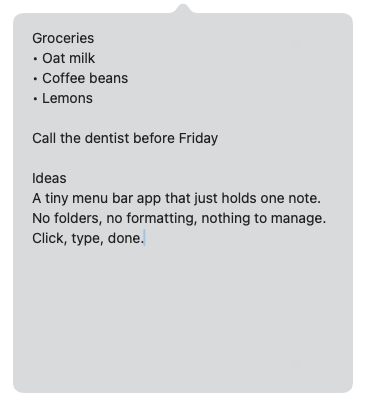

<div align="center">


# Node

**One note, one click away in the menu bar.**

Click the icon, type, click away. That's it.


</div>

---

Node sits next to your Wi‑Fi and Bluetooth icons. Click it and a native macOS panel drops down with a single text box. Write anything. Click anywhere else and it closes, just like the system menus. Your note stays put across quits, restarts and reboots.

<p align="center">
  <picture>
    <source media="(prefers-color-scheme: dark)" srcset="docs/screenshot-dark.png">
    
  </picture>
</p>

## ✨ Features

|   |   |
|---|---|
| 📝 **Just a text box** | No titles, folders or formatting. Open it and start typing. |
| 🍎 **Native look** | System font, translucent popover, accent‑colored cursor. Follows light and dark mode. |
| ⌨️ **Familiar shortcuts** | ⌘C ⌘V ⌘X ⌘A, ⌘Z / ⇧⌘Z to undo and redo, ⌘F to search. |
| 🪶 **Featherweight** | Pure AppKit: no SwiftUI, no WebKit, no timers. About 13 MB of RAM and 0% CPU when idle. No Dock icon, no network access. |

## 🛡 Your note is never lost

- **Auto-save:** saved a moment after you stop typing, again when the panel closes, and again on quit, logout or shutdown.
- **Atomic writes:** the file is replaced in one step, so a crash mid-save can't leave half a note.
- **Daily snapshots:** one copy per day, kept for 30 days in `Snapshots/`. If the main file can't be read, the newest snapshot is loaded instead.
- **Rebuild-safe:** rebuilding or replacing `Node.app` never touches your note.

```
~/Library/Application Support/Node/
├── note.txt      # your note (plain UTF-8 text)
└── Snapshots/    # note-YYYY-MM-DD.txt, last 30 days
```

## 🚀 Getting started

**Requirements:** macOS 13 Ventura or later, and the Xcode Command Line Tools (`xcode-select --install`).

```sh
git clone https://github.com/faithere1/Node.git
cd Node
./build.sh
open Node.app
```

`build.sh` compiles the app, renders its icon and bundles everything into `Node.app`. Move it to `/Applications` if you like.

> **Tip:** To launch Node automatically, add it under **System Settings → General → Login Items**.

## 🖱 Usage

| Action | How |
|---|---|
| Show / hide the note | Click the menu bar icon |
| Close | Click anywhere else, or click the icon again |
| Show saved note / Quit | Right-click the menu bar icon |

## 🧱 Project structure

```
Sources/
└── main.swift        # menu bar icon, text box, saving to disk
Tools/
└── make_icon.swift   # renders the app icon
build.sh              # builds Node.app
```

## 📄 License

[MIT](LICENSE) © faithere1

---

<div align="center">
<sub>Made with care for a quieter mind.</sub>
</div>
